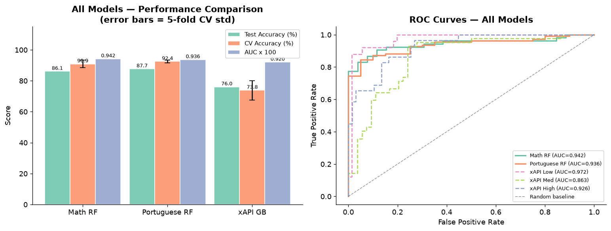
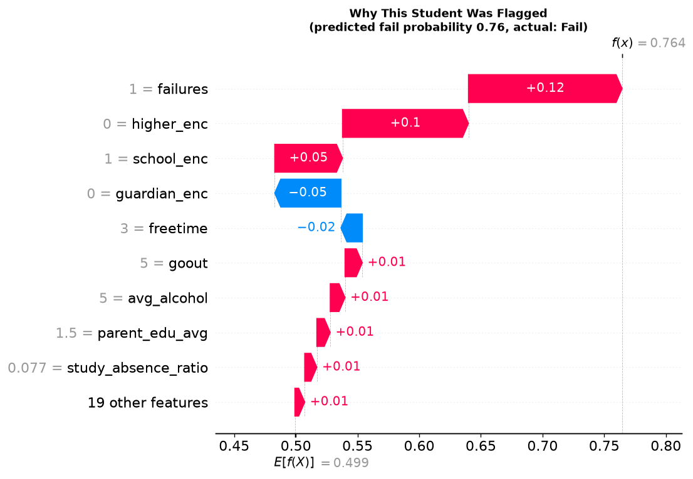
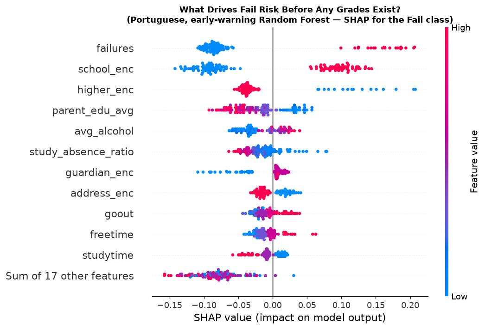

# 🎓 Student Performance Analytics

**Can we spot students who are likely to fail, early enough to help them?**

This project uses data mining on **1,524 students from three datasets** to predict who passes or fails, explain why, and group students by how they learn.

Master of Data Science & AI coursework, **University of Moratuwa** (2026). Full write-up: [report.pdf](report.pdf) (IEEE format).



## Results at a glance

| Model | Predicts | Test accuracy | AUC |
|---|---|---|---|
| Random Forest | Math pass/fail | **86.1%** | 0.942 |
| Random Forest | Portuguese pass/fail | **87.7%** | 0.936 |
| Gradient Boosting | Platform activity → Low / Medium / High | **76.0%** | 0.920 |

Results were checked with a held-out test set **and** 5-fold cross-validation (90.9%, 92.5% and 73.9%).

## What I found

1. **Earlier grades matter most.** The first- and second-term grades are the strongest predictors, followed by past failures.
2. **A simple rule matched the models.** "Pass if the second-term grade ≥ 10" scored 87.3% on Math, as good as Random Forest. Comparing models with simple baselines matters.
3. **Predicting before any grades exist is much harder.** Without grades, AUC drops to about **0.65**. Adding just the first-term grade brings it back to **0.83–0.87**, early enough to step in.
4. **What drives risk early on (SHAP):** past failures, the school attended, and plans for higher education. Many of these describe background, not effort, so a tool like this should be used to **offer support, not to label students**.
5. **Three learner types** appear in platform activity: Active, Moderate and Passive. They closely match real performance.
6. **Behaviour patterns:** high absence is linked to low performance (lift 2.31). Past failures plus high alcohol use are linked to failing (lift 2.06).
7. **Same students, different subjects:** Portuguese grades are 2.13 points higher than Math on average (paired t-test, p < 10⁻²⁰).

| Why one student was flagged | Overall risk drivers |
|---|---|
|  |  |

## The data

| Dataset | Students | What we predict |
|---|---|---|
| UCI Student Performance (Math) | 395 | Pass / fail (final grade ≥ 10 of 20) |
| UCI Student Performance (Portuguese) | 649 | Pass / fail |
| xAPI-Edu-Data (learning-platform activity) | 480 | Low / Medium / High performance |

## What I did

| Step | Methods |
|---|---|
| Clean the data | Checked missing values, duplicates and out-of-range values; encoded labels; added features such as grade trend and study-to-absence ratio |
| Explore | Grade distributions, correlation heatmaps, cross-subject comparison |
| Predict | Random Forest and Gradient Boosting, compared with simple baselines and Logistic Regression |
| Explain | SHAP values for overall drivers and for single students |
| Group | K-Means clustering, shown with PCA |
| Find patterns | Association rules (Apriori: support, confidence, lift) |
| Test | Paired t-test and correlation between subjects |

## Skills shown

Python · pandas · NumPy · scikit-learn · SHAP · mlxtend · SciPy · Matplotlib · seaborn · Jupyter · data cleaning · classification · clustering · association rules · hypothesis testing · model explainability

## Run it yourself

```bash
git clone https://github.com/YasithaNV2001/student-performance-analytics.git
cd student-performance-analytics
python -m venv venv
venv\Scripts\activate        # macOS/Linux: source venv/bin/activate
pip install -r requirements.txt
jupyter notebook analysis.ipynb
```

The notebook creates all 16 figures in `figures/`. Every model uses `random_state=42`, so the results are reproducible.

**Tested with Python 3.12.** The library versions in `requirements.txt` are pinned because newer releases change the results slightly (scikit-learn 1.9, for example, moves Math accuracy from 86.1% to 87.3%). Two AUC values differ from the report by less than 0.003, most likely because the report was made with older library versions.

## What's in this repo

```
├── analysis.ipynb        # the full analysis, with outputs
├── report.pdf            # IEEE-format report (revised September 2026)
├── paper/                # LaTeX source, report figures, original April 2026 version
├── data/raw/             # original datasets
├── data/processed/       # cleaned datasets (made by the notebook)
├── figures/              # all 16 figures (made by the notebook)
└── requirements.txt
```

The report was revised in September 2026 to correct errors in the first submission; the changes are listed in its appendix, and the original is kept in `paper/`.

## Data sources

- P. Cortez and A. Silva, "Using data mining to predict secondary school student performance," *FUBUTEC*, 2008. [UCI Machine Learning Repository](https://archive.ics.uci.edu/dataset/320/student+performance)
- E. A. Amrieh, T. Hamtini and I. Aljarah, "Mining educational data to predict student's academic performance using ensemble methods," *Int. J. Database Theory and Application*, 2016. [Kaggle: xAPI-Edu-Data](https://www.kaggle.com/datasets/aljarah/xAPI-Edu-Data)

## Author

**Yasitha Priyashan** · Master of Data Science & AI, University of Moratuwa · [GitHub](https://github.com/YasithaNV2001)
